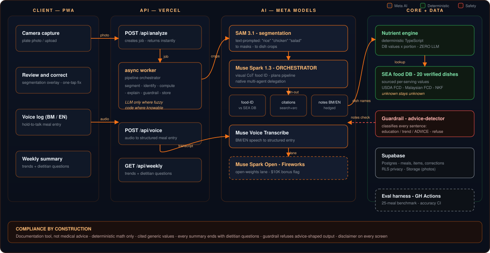

<h1 align="center">RenalRadar</h1>

<b>A camera-and-voice meal companion for kidney patients in Southeast Asia.</b>

<i>Point at your plate. Know what's on it. Bring better questions to your dietitian.</i>

  
  
  
  

---

## The problem

More than **5 million Malaysians** live with chronic kidney disease (CKD), and **51,000+ are
already on dialysis** — projected to pass **106,000 by 2040** (Galen Centre, 2024). Diabetes
drives **54.6%** of new dialysis cases. CKD is silent, irreversible, and managed daily through
one hard skill: knowing what is on your plate.

That skill fails in Malaysia for a simple reason: the food is local, and the databases are not.
Nasi lemak, laksa, char kuey teow, teh tarik — generic nutrition apps either don't know these
dishes or return nothing. Patients guess. Dietitians start from zero every visit.

## What RenalRadar does

1. **Photograph the plate.** SAM 3.1 segments every dish on it — rice, sambal, chicken, salad —
   in one shot.
2. **Identify each dish.** Muse Spark (multimodal, visual chain-of-thought) matches the crops
   against a curated Southeast-Asian food database (BM/EN).
3. **Compute the numbers.** Sodium, potassium, phosphorus, protein, fluid — calculated by
   deterministic code from sourced per-serving values. No LLM touches the math.
4. **Explain, with citations.** Concern notes in Bahasa Malaysia or English, every claim linked
   to public patient-nutrition sources.
5. **Log by voice.** "Tengah hari saya makan nasi lemak" → a structured meal entry.
6. **Prepare the conversation.** A weekly summary that ends with questions for the dietitian —
   never instructions.

## Compliance-first (the core design decision)

RenalRadar is a **documentation and literacy tool**, not a medical advisor. That distinction is
enforced in code, not prose:

- A **guardrail pass** classifies every generated sentence (education / data-trend / advice).
  Advice-shaped output is rewritten into a question or removed.
- Nutrient values are **generic, published, sourced** — no personalized targets, no severity
  scoring, no prescriptions.
- Unknown values stay marked **unknown** — the database never invents.
- Every screen carries: *not medical advice — discuss with your healthcare team.*

See [COMPLIANCE.md](./COMPLIANCE.md) for the full contract.

## Architecture

*Editable source: [docs/architecture.drawio](docs/architecture.drawio) — open in diagrams.net.*

**Principles:** deterministic separate from generative · refusal paths over guesses ·
provenance on every value · user corrections are first-class data.

## Screens (7)

Camera capture · Review & correct (segmentation overlay) · Nutrient breakdown + citations ·
Voice log (BM/EN) · Food history · Weekly summary + dietitian questions · Settings (language,
disclaimer, data export).

## Stack

Next.js (PWA) · TypeScript · Tailwind · Supabase (Postgres, Storage, RLS) · Meta Model API
(SAM 3.1, Muse Spark, Muse Voice Transcribe) · Fireworks (Muse Spark Open lane) ·
GitHub Actions (eval harness).

## Built for

**Meta Global AI Developer Hackathon** — indie track. All core code in this repository was
written during the building window (Oct 27 – Nov 4, 2026); see the commit history.
The Southeast-Asian food database uses public sources only (USDA FoodData Central, Malaysian
Food Composition Database, NKF patient-education materials) — each entry carries its source.

## Roadmap

- [ ] v1 (hackathon): capture → segmentation → identification → nutrients → notes → voice → summary
- [ ] v1.1: open-weights lane (Muse Spark Open) + evaluation report published
- [ ] v2: accounts, 100+ dish database with community corrections, dietitian sharing portal
- [ ] v2.1: phosphorus-additive detection (ingredient-label OCR), Flutter companion

## Disclaimer

RenalRadar is an educational and documentation tool. It does not provide medical advice.
Always consult your nephrologist or renal dietitian for personalized recommendations.
